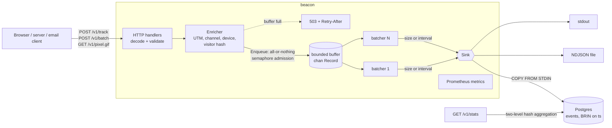

# beacon

**A small, self-hostable analytics event collector in Go: tracks pageviews, clicks and campaigns at hundreds of thousands of events per second, without storing a single IP address.**

[](https://github.com/marcus-girolneto/beacon/actions/workflows/ci.yml)
[](https://pkg.go.dev/github.com/marcus-girolneto/beacon)
[](https://goreportcard.com/report/github.com/marcus-girolneto/beacon)
[](LICENSE)

## Why

Marketing teams want to know which campaigns, channels and pages drive traffic. The usual answer is a third-party script that ships every visitor's IP, cookies and browsing history to someone else's servers. Hosted alternatives (Segment, Plausible, PostHog) solve that but cost money or need a whole platform to run.

beacon is the ingestion half of such a system, built as a single static binary: it accepts events over HTTP, validates and enriches them (UTM attribution, channel, device, privacy-safe visitor hash), buffers them in memory and bulk-loads them into Postgres. The interesting engineering is in the middle: a bounded, batching pipeline that keeps request latency flat, sheds load explicitly when the database falls behind, and drains cleanly on shutdown.

## Features

- **Ingestion API**: `POST /v1/track` (one event), `POST /v1/batch` (up to 500), and `GET /v1/pixel.gif` (1x1 tracking pixel for emails and no-JS pages). Works with `navigator.sendBeacon` (`text/plain` bodies, CORS without credentials).
- **Strict validation**: unknown fields, trailing data, oversized bodies, bad URLs, control characters, timestamps from the future or more than 7 days old: each rejected with a specific 4xx and a per-field error list.
- **Enrichment**:
  - UTM parameters parsed from the page URL when the client did not send them, then normalized.
  - Acquisition channel: `search`, `social`, `email`, `paid`, `referral` or `direct`, from `utm_medium`, ad click IDs (`gclid`, `msclkid`, ...) and the referrer.
  - Device class (`desktop` / `mobile` / `tablet` / `bot`) from a small hand-written User-Agent classifier.
  - **Privacy**: IP + User-Agent become a daily-rotating, non-reversible visitor hash; neither is ever stored. Query strings are stripped from stored URLs.
- **Pipeline**: bounded buffer, N batcher goroutines flushing by size *or* interval, retries with backoff, all-or-nothing admission for batches, explicit backpressure (`503` + `Retry-After`, or bounded blocking), graceful drain on `SIGTERM`.
- **Sinks**: Postgres (COPY protocol), NDJSON file (fsync per batch), stdout.
- **Stats API**: `GET /v1/stats?from=&to=&group_by=utm_campaign|utm_source|channel|path|device|day` with events, pageviews and unique visitors, plus totals.
- **Operations**: Prometheus metrics, structured logs (`log/slog`), `/healthz` and `/readyz` probes, distroless image (24 MB), docker-compose stack.
- **`loadgen`**: a load generator that fires realistic marketing traffic (search/social/email/paid mix, device split, returning visitors) and reports throughput and latency percentiles.

## Quick start

```sh
git clone https://github.com/marcus-girolneto/beacon && cd beacon
docker compose up -d --build            # postgres + beacon on :8080
go run ./cmd/loadgen -duration 10s      # fire synthetic traffic
curl "localhost:8080/v1/stats?from=$(date -u +%F)&to=$(date -u -v+1d +%F 2>/dev/null || date -u -d tomorrow +%F)&group_by=channel"
```

Without Docker, the stdout sink needs nothing else:

```sh
go run ./cmd/beacon -sink stdout
```

Ports clash? `BEACON_PORT=18080 POSTGRES_PORT=15432 docker compose up -d`.

## Usage

The output below comes from real runs against a local stack (ports changed to the defaults).

**Track one event.** UTM tags are read from the URL, the referrer and `utm_medium` decide the channel:

```console
$ curl -si -X POST localhost:8080/v1/track -H 'Content-Type: application/json' -d '{
    "type": "pageview", "anonymous_id": "a-42",
    "url": "https://shop.example.com/pricing?utm_source=Google&utm_medium=cpc&utm_campaign=fall_launch",
    "referrer": "https://www.google.com/"}'
HTTP/1.1 202 Accepted
Access-Control-Allow-Origin: *
Content-Type: application/json
Content-Length: 15

{"accepted":1}
```

**Validation errors** list every bad field at once:

```console
$ curl -s -X POST localhost:8080/v1/track -H 'Content-Type: application/json' -d '{"type":"purchase","url":"/pricing"}'
{"error":"invalid event","fields":[{"field":"type","message":"must be one of pageview, click, custom"},{"field":"anonymous_id","message":"is required"},{"field":"url","message":"must be an absolute http(s) URL"}]}
```

**Batches** accept the valid events and report the invalid ones by index:

```console
$ curl -s -X POST localhost:8080/v1/batch -H 'Content-Type: application/json' -d '{"batch":[
    {"type":"click","name":"cta_hero","anonymous_id":"a-42","url":"https://shop.example.com/"},
    {"type":"custom","anonymous_id":"a-42","url":"https://shop.example.com/signup"}]}'
{"accepted":1,"rejected":[{"index":1,"fields":[{"field":"name","message":"is required for custom events"}]}]}
```

**Tracking pixel**, e.g. in a newsletter (`url` defaults to the `Referer` header):

```console
$ curl -s -o /dev/null -w '%{http_code} %{content_type} %{size_download} bytes\n' \
    "localhost:8080/v1/pixel.gif?aid=a-7&url=https%3A%2F%2Fshop.example.com%2Fblog&utm_source=newsletter&utm_medium=email&utm_campaign=october_digest"
200 image/gif 43 bytes
```

Parameters: `t` (type, default `pageview`), `n` (name), `aid` (anonymous id), `url`, `ref`, `utm_source`, `utm_medium`, `utm_campaign`, `utm_term`, `utm_content`. The pixel always returns the GIF, so a rejected hit never renders as a broken image; the status code still tells you what happened.

**Stats.** `from`/`to` accept dates or RFC 3339 timestamps (`to` is exclusive); optional `host` and `limit`. This is from the 10.4M-event benchmark dataset:

```console
$ curl -s "localhost:8080/v1/stats?from=2026-10-01&to=2026-11-01&group_by=utm_campaign&limit=4"
{"from":"2026-10-01T00:00:00Z","to":"2026-11-01T00:00:00Z","group_by":"utm_campaign",
 "totals":{"events":10410600,"pageviews":8328589,"visitors":9913},
 "rows":[{"key":"(none)","events":8431106,"pageviews":6744662,"visitors":9913},
         {"key":"brand_search","events":833527,"pageviews":666826,"visitors":9910},
         {"key":"october_digest","events":625071,"pageviews":500622,"visitors":9893},
         {"key":"fall_launch","events":520896,"pageviews":416479,"visitors":9897}]}
```

(Line breaks added for readability.)

### Configuration

Every flag can also be set as `BEACON_<FLAG>` (e.g. `-flush-interval` is `BEACON_FLUSH_INTERVAL`). Flags win over the environment. `beacon -h` lists all of them; the important ones:

| Flag | Default | Meaning |
|---|---|---|
| `-sink` | `stdout` | `stdout`, `file` or `postgres` |
| `-postgres-dsn` | | connection string for the postgres sink |
| `-buffer-size` | `10000` | events held in memory between handlers and batchers |
| `-batch-size` / `-flush-interval` | `500` / `1s` | flush when either is reached |
| `-workers` | `2` | batcher goroutines (concurrent sink writes) |
| `-overflow` | `reject` | full buffer: `reject` (503 now) or `block` (wait up to `-block-timeout`) |
| `-retry-after` | `1s` | `Retry-After` sent with 503s |
| `-proxy-hops` | `0` | trusted proxies in front; `0` ignores `X-Forwarded-For` |
| `-shutdown-timeout` | `30s` | time allowed to drain on `SIGTERM` |

### Metrics

`GET /metrics` exposes, besides Go runtime metrics:

| Metric | Type | Labels |
|---|---|---|
| `beacon_events_accepted_total` | counter | `endpoint` |
| `beacon_events_rejected_total` | counter | `reason` (`invalid`, `malformed`, `too_large`, `content_type`, `internal`) |
| `beacon_events_dropped_total` | counter | `reason` (`buffer_full`, `shutting_down`, `canceled`) |
| `beacon_events_written_total` / `beacon_events_lost_total` | counter | |
| `beacon_batch_size` | histogram | |
| `beacon_flush_duration_seconds` | histogram | `result` |
| `beacon_flushes_total` | counter | `trigger` (`size`, `interval`, `shutdown`), `result` |
| `beacon_buffer_occupancy` / `beacon_buffer_capacity` | gauge | |
| `beacon_http_request_duration_seconds` | histogram | `route`, `code` |

`accepted - written - lost - buffer_occupancy` is the number of events in flight; alert on `events_lost_total > 0` and on `events_dropped_total` rate.

## Architecture



Request path: decode (strict JSON, size-limited) → validate → enrich → `Enqueue`. The handler returns `202` as soon as the record is in the buffer; it never waits for the database.

Shutdown order on `SIGTERM`: `/readyz` starts failing → the HTTP server stops accepting and finishes in-flight requests → the buffer is closed and the batchers flush everything left → the sink is closed. Anything acknowledged with `202` before the signal is written.

## Design decisions and trade-offs

### Channel-based batching instead of a write per request

A write per request couples HTTP latency to database latency and turns 50k requests/s into 50k transactions/s, which Postgres cannot sustain and which collapses under any database hiccup. Batching amortizes the round trip, the transaction and the WAL flush over hundreds or thousands of rows.

The buffer is a Go channel guarded by a weighted semaphore (`golang.org/x/sync/semaphore`). The channel gives cheap hand-off to the batchers. The semaphore gives two things a bare channel cannot: a `/v1/batch` request of 50 events is admitted **all-or-nothing** (no half-written batch, so a client that gets a 503 can retry the whole request without duplicates), and "block" mode can wait with a deadline. A batch flushes at `-batch-size` events or after `-flush-interval`, so throughput is high under load and latency to storage stays bounded when traffic is low.

Rejected: a mutex-protected slice swapped by a flusher (simpler, but every producer contends on one lock and admission control has to be rebuilt by hand), and an external queue (see durability below).

### COPY instead of INSERT

Batches go to Postgres through `pgx.CopyFrom` (`COPY ... FROM STDIN`, binary format): one round trip, no SQL parsing per row, no bind-parameter limit (65,535 parameters caps a multi-row `INSERT` at about 3,000 rows for this 20-column table). In the benchmarks below a 2,000-row COPY takes about 20 ms, around 100k rows/s per connection. COPY is also atomic per batch, which keeps retry semantics simple.

The cost: COPY cannot do `ON CONFLICT`, so retries can create duplicates (see delivery semantics). The fix is to COPY into a temporary staging table and `INSERT ... SELECT ... ON CONFLICT (message_id) DO NOTHING`, which costs a unique index on a write-heavy table. We did not pay that cost for analytics counts, where a rare duplicate does not matter. Every record has a `message_id` (client-supplied or generated), so this upgrade needs no API change.

The table has no primary key and a BRIN index on `ts`: events arrive almost in time order, so BRIN is a tiny, nearly free index that still prunes time-range scans.

### Drop or block when the buffer is full

When Postgres falls behind, the buffer fills up. Something has to give, and we made that an explicit, configurable choice:

- **`reject` (default)**: `Enqueue` fails at once and the client gets `503` with `Retry-After`. Request latency stays flat, memory stays bounded, and the retry decision goes to the client, which can hold events (the browser's `sendBeacon` queue, a server-side SDK's retry buffer). Load shedding is visible in `beacon_events_dropped_total`.
- **`block`**: the handler waits up to `-block-timeout` for room, then answers 503. This absorbs short bursts (a slow checkpoint, a vacuum) at the cost of holding connections and goroutines open. Unbounded blocking was rejected: it turns a slow database into a slow collector, then into exhausted connections in front of it.

Reject is the default because an analytics collector must never become the slow dependency of the site that embeds it. Losing a fraction of pageviews during an incident beats adding latency to every page.

### Delivery semantics: at-most-once, and how to get at-least-once

`202 Accepted` means "in memory", not "on disk". Events in the buffer are lost if the process is killed with `SIGKILL`, the host loses power, or the sink fails past all retries (counted in `events_lost_total`). Graceful shutdown drains everything, so deploys and scale-downs lose nothing; see the drain test in the benchmarks. Overall this is **at-most-once** delivery with retries that, on a write that timed out but actually committed, can occasionally make it at-least-once for one batch.

That is the right trade for web analytics: browsers already lose events (ad blockers, closed tabs), and the numbers are used as trends. For billing-grade events we would make the acknowledgement durable:

1. **Local WAL**: append each accepted request to a segmented, fsynced log before answering `202` (group commit every few ms keeps throughput), have the batchers read from the log, and checkpoint the offset after each successful COPY. On restart, replay from the checkpoint. With the staging-table dedupe above, that gives effectively-once storage. The NDJSON file sink is already half of this.
2. **Kafka / Redpanda** in front: handlers produce with `acks=all` and answer after the broker acknowledges; a consumer group does the batching and commits offsets after COPY. Durability, replay and fan-out to other consumers (a warehouse, a real-time dashboard) come for free; the price is running a broker, and request latency now includes a replicated write.

The `pipeline.Sink` interface is the seam for either: a WAL or Kafka producer is just another sink, and the current batchers become the consumer.

### Privacy: hashing instead of storing IPs

Counting unique visitors needs some notion of identity, but an IP address is personal data under GDPR, and so is a long-lived cookie ID. beacon follows the approach popularized by Plausible:

```
visitor_hash = HMAC-SHA256(daily_salt, site_host | ip | user_agent)[:16]
```

- `daily_salt` is 32 random bytes generated per UTC day, held **only in memory**, and discarded at midnight. Without it, nobody (including whoever runs the server or a database dump) can link a hash back to an IP, even by hashing all 2^32 IPv4 addresses, and hashes from different days cannot be joined to follow someone over time.
- Including the site host means the same person gets unrelated hashes on two sites served by one collector.
- The raw IP and User-Agent are used during the request and then dropped; only the device class survives. Query strings are cut from stored URLs and referrers, since they often carry emails or tokens; UTM tags and click IDs are extracted first.

What this means for the data: "visitors" are **daily unique visitors**. One person active on three days counts three times in a monthly total, and two people behind the same NAT with the same browser build count once. That is the price of not keeping anything that identifies a person. `anonymous_id` is stored as the client sends it; whether that is a cookie or a per-session random value is the site's consent decision, not the collector's.

Known limitation: the salt lives in process memory, so a restart or a second replica starts a new salt and splits that day's visitors (the benchmark dataset shows this: 5,000 synthetic visitors read as about 9,900 after one restart). The fix is to keep the current day's salt in a small Postgres table, shared by replicas and deleted at rotation. That puts the salt next to the hashes for one day, a trade we have not made yet.

### Stats queries

`count(DISTINCT visitor_hash)` forces Postgres into a single-threaded sort: 23 s on 11M rows on the benchmark machine. The stats query groups by `(key, visitor_hash)` first and then counts rows per key. Both steps are parallel hash aggregates, which brought the same query down to 4.6 s. Totals get their own pass, because one visitor can appear under several keys. `group_by` values map to a fixed set of SQL expressions, so user input never reaches the SQL text. Queries are bounded by `-stats-timeout` (504 after that).

Querying the raw table is fine up to tens of millions of rows. Past that, the next steps are a daily rollup table (or a materialized view refreshed incrementally) keyed by `(day, host, dimension, value)` with HyperLogLog sketches for visitors, and eventually a columnar store. We deliberately did not start with ClickHouse: one Postgres is something every team already runs.

### Smaller decisions

- **Hand-written UA classifier** (about 40 substring tokens) instead of a UA database: dashboards need desktop/mobile/tablet/bot splits, not browser versions. It runs in about 1 µs and needs no updates. Known blind spot: iPadOS in desktop mode says "Macintosh".
- **Strict JSON** (`DisallowUnknownFields`, single value only): a typo such as `anonymousId` fails loudly instead of silently dropping data.
- **Interfaces at the consumer**: `api.Enqueuer`, `api.StatsQuerier`, `pipeline.Sink` and `pipeline.Observer` are each one or two methods, defined where they are used, so tests use small fakes and no mocking framework.
- **Separate Prometheus registry** per instance instead of the global one: tests stay isolated and nothing is registered at import time.

## Testing

```sh
make test               # unit tests with -race (no Docker needed)
make test-integration   # + Postgres via testcontainers (Docker required)
make fuzz               # fuzz the UTM parser for 30s
make bench              # micro-benchmarks
make cover              # coverage summary
make lint               # go vet + golangci-lint
```

What is covered:

- **Validation**: a table of more than 30 cases (every field, size limits, UTF-8 and control characters, clock skew, multi-error reporting).
- **Enrichment**: tables for UTM parsing (malformed escapes, duplicates, truncation on rune boundaries), channel attribution (precedence of `utm_medium` over click IDs over referrer, lookalike domains such as `notgoogle.com`), and User-Agent classes. A **fuzz test** checks that `ParseUTM` never panics and always returns trimmed, valid UTF-8 values within the size limit that pass the validator. Visitor hashing is tested for daily rotation, input separation, entropy failure and concurrent rotation.
- **Pipeline**: deterministic and free of sleeps. A manual ticker drives interval flushes, and a gated fake sink holds a batcher inside `Write` so the buffer fills on purpose. Covered: size trigger, interval trigger, drain on shutdown with several workers (no record lost or duplicated), reject and block backpressure, all-or-nothing admission, block timeout, shutdown releasing blocked producers, retries and loss accounting.
- **HTTP**: `httptest` tables for every status code (202, 400, 413, 415, 499, 501, 503 with `Retry-After`, 504), pixel behavior, CORS preflight, `X-Forwarded-For` trust, plus an end-to-end test through the real pipeline.
- **Postgres** (integration): COPY round trip, JSONB properties, every stats dimension, totals surviving `LIMIT`, host filter, empty ranges, concurrent migrations; plus an end-to-end test from HTTP ingestion to the stats endpoint.

Coverage: **88.6%** of statements from unit tests alone, **94.4%** with integration tests (100% on `enrich`, `config`, `metrics`, `stats`; 98% on `pipeline`).

## Benchmarks

Machine: Apple M2 Max (12 cores, 32 GB), macOS 26, Go 1.27.2. beacon runs natively; Postgres 17 runs in Docker Desktop with default settings; `loadgen` runs on the same machine. The laptop was **not idle** (load average around 15 to 24 from other applications), so treat these as order-of-magnitude numbers: run-to-run variation was about ±30%.

### Load tests (`cmd/loadgen`, 30 s each, Postgres sink)

| Scenario | Config | Accepted events/s | Shed (503) | p50 | p99 |
|---|---|---:|---:|---:|---:|
| `/v1/track`, 64 connections, unthrottled | default (2 workers, batch 500) | 53,628 | 0% | 0.72 ms | 8.2 ms |
| `/v1/track`, 64 connections, fixed 20k req/s | default | 19,737 | 0% | 0.53 ms | 3.7 ms |
| `/v1/batch` x50, 32 connections, unthrottled | default | 72,781 | 70% of requests | 3.4 ms | 47 ms |
| `/v1/batch` x50, 32 connections, unthrottled | 4 workers, batch 2000, buffer 50k | **364,926** | 10% of requests | 2.8 ms | 19 ms |

What this shows:

- With defaults, single-event ingestion is limited by HTTP and JSON work, not by storage: nothing is shed.
- Batched ingestion with defaults is **sink-bound**: two COPY workers cannot keep up, the buffer fills, and beacon sheds 70% of requests with 503s while latency stays bounded. That is the backpressure design doing its job instead of queueing without limit. Doubling the workers, quadrupling the batch size and growing the buffer 5x raised sustained throughput about 5x.
- Latency includes loadgen's own client overhead on the same CPU.

**Drain under load.** SIGTERM sent 3 s into a 6 s run at about 170k events/s: loadgen got **1,025,600** `202` responses, and Postgres held exactly **1,025,600** rows afterwards. The drain took 13 ms. Requests after the signal failed with connection errors, as intended.

**No silent loss.** Across all runs, `beacon_events_written_total` equalled `beacon_events_accepted_total` and `beacon_events_lost_total` stayed at 0.

**Stats on 10.4M rows** (`from`/`to` spanning the whole month): `device` 2.2 s, `utm_campaign` 2.6 s, `path` 3.7 s, `channel` 4.3 s, `day` 6.9 s.

### Micro-benchmarks (`make bench`)

```
BenchmarkTrackHandler-12        478756     2111 ns/op    9853 B/op     60 allocs/op
BenchmarkBatchHandler50-12       20001    62129 ns/op  146437 B/op   1102 allocs/op
BenchmarkClassifyDevice-12     1000000     1178 ns/op     144 B/op      1 allocs/op
BenchmarkEnrich-12              521768     2281 ns/op    1074 B/op     20 allocs/op
BenchmarkEnqueue-12            1448642    891.4 ns/op     207 B/op      2 allocs/op
BenchmarkEnqueueBatch100-12      60646    20792 ns/op     594 B/op      8 allocs/op
```

The track handler benchmark covers the full path (decode, validate, enrich, admit into a real pipeline) at about 2 µs per event. Per-event costs are dominated by `encoding/json` and the HMAC.

## Project layout

```
.
├── cmd/
│   ├── beacon/          # server entry point: flags, logging, signals
│   └── loadgen/         # load generator CLI
├── internal/
│   ├── api/             # HTTP handlers, validation errors, backpressure responses
│   ├── app/             # wiring and ordered graceful shutdown
│   ├── config/          # flags + BEACON_* environment variables
│   ├── enrich/          # UTM parsing, channel attribution, UA classifier, visitor hashing
│   ├── event/           # event model and validation rules
│   ├── loadgen/         # synthetic traffic generator and runner
│   ├── metrics/         # Prometheus collectors
│   ├── pipeline/        # bounded buffer, batchers, retries, drain
│   ├── postgres/        # COPY sink, schema, stats queries
│   ├── sink/            # NDJSON stdout and file sinks
│   └── stats/           # stats query model
├── Dockerfile           # multi-stage, distroless, non-root
├── docker-compose.yml   # postgres + beacon
└── Makefile
```

## Roadmap and limitations

- **Durability**: at-most-once (see above). A WAL or Kafka in front of the batchers is the next step for use cases that need more.
- **Duplicates**: retries after an ambiguous COPY failure can duplicate a batch; staging-table dedupe on `message_id` is designed but not built.
- **Shared salt**: visitor hashes are per process; replicas and restarts split a day's unique visitors.
- **Stats at scale**: raw-table aggregation is seconds at 10M rows. Daily rollups with HLL sketches come next; time-based partitioning would also make retention a cheap `DROP PARTITION`.
- **No auth on the stats endpoint**: put it behind your gateway or bind it to an internal network. Ingestion is public by design, so rate limiting per IP belongs at the edge.
- **No bot filtering at query time**: bots are classified (`device = bot`) but still counted; a `-drop-bots` flag or a stats filter is an easy addition.
- **No geo enrichment**: deliberately, since it would need the IP and a GeoIP database.

## License

[MIT](LICENSE) © 2026 Marcus Vinicius Girolneto Sousa
